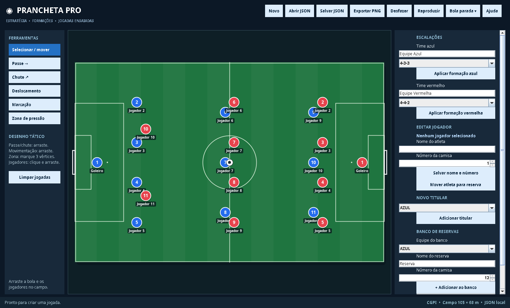
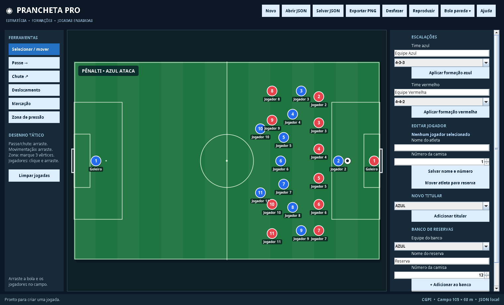
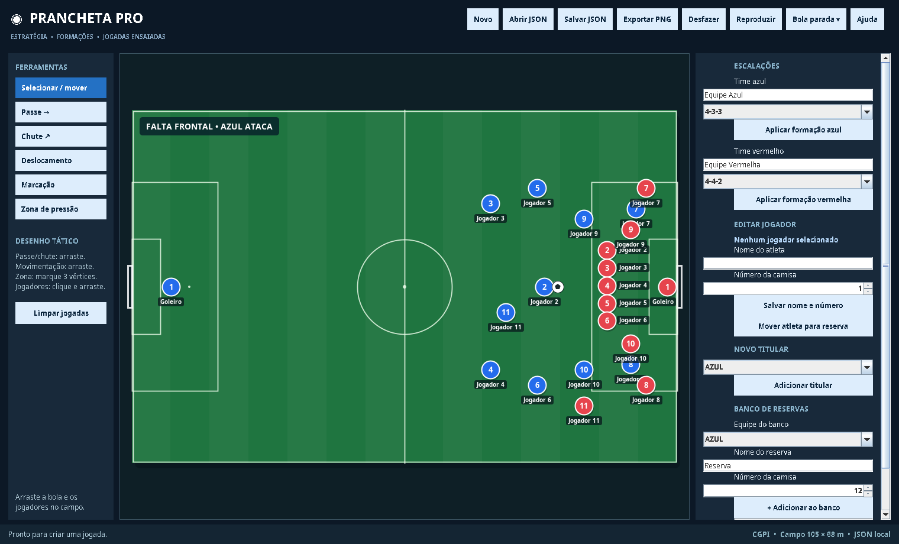

# Prancheta Pro — Simulador Tático Interativo de Futebol

Prancheta tática digital feita em **Java Swing**: posicione os 22 jogadores num campo em escala real, aplique formações, desenhe passes, chutes e marcações, simule bolas paradas e reproduza as jogadas em animação.

Projeto extensionista de Computação Gráfica / Estruturas Dinâmicas. Sem dependências externas, só a biblioteca padrão do Java (compilado para Java 8+).



## Funcionalidades

- **22 titulares** (11 por equipe), bola e campo proporcional (105 × 68 m)
- **12 formações:** 4-3-3, 4-4-2, 4-2-3-1, 3-5-2, 3-4-3, 4-1-4-1, 5-3-2, 4-5-1, 4-3-2-1, 3-4-2-1, 4-2-2-2 e 4-1-2-1-2
- **Personalização** de nomes, números e equipes, com banco de reservas e substituições
- **Ferramentas táticas:** passe, chute, deslocamento, marcação e zona de pressão (polígono)
- **Bolas paradas:** pênalti, falta frontal e escanteios, com reposicionamento automático de jogadores e bola (ambos os times podem cobrar)
- **Reprodução animada** das jogadas registradas
- **Salvar/abrir JSON** e **exportar PNG** do campo
- **Desfazer** ilimitado (`Ctrl+Z`)

##  Capturas de tela

| Pênalti | Falta frontal |
|---|---|
|  |  |

##  Como executar

**Requisito:** Java 8 ou superior instalado.

### Opção 1 — JAR pronto
```bash
java -jar Prancheta_Tatica_Futebol.jar
```
(ou dê dois cliques no arquivo)

### Opção 2 — BlueJ
1. Abra o BlueJ → **Projeto → Abrir Projeto** → pasta `Prancheta_Tatica_Futebol_BlueJ`
2. Clique em **Compilar**
3. Botão direito na classe `Main` → `void main(String[] args)`

### Opção 3 — Terminal
```bash
cd Prancheta_Tatica_Futebol_BlueJ
javac *.java
java Main
```

##  Como usar

| Ação | Como fazer |
|---|---|
| Mover jogador/bola | Ferramenta *Selecionar / mover* e arraste |
| Aplicar formação | Escolha a formação do time e clique em *Aplicar formação* |
| Editar jogador | Selecione no campo, altere nome/número e salve |
| Substituição | Selecione o titular + reserva da mesma equipe na lista |
| Passe / Chute / Deslocamento / Marcação | Pressione, arraste e solte |
| Zona de pressão | Clique em três pontos para formar o polígono |
| Bola parada | Menu *Bola parada* (pênalti, falta frontal, escanteios) |
| Reproduzir | Anima as jogadas registradas |
| Salvar / Abrir / Desfazer | `Ctrl+S` / `Ctrl+O` / `Ctrl+Z` |

Há um arquivo de exemplo em [`Prancheta_Tatica_Futebol_BlueJ/exemplo_jogada.json`](Prancheta_Tatica_Futebol_BlueJ/exemplo_jogada.json) — abra-o pelo botão **Abrir JSON**.

##  Estrutura do projeto

```
.
├── Prancheta_Tatica_Futebol.jar          # executável
├── Prancheta_Tatica_Futebol_BlueJ/       # código-fonte (projeto BlueJ)
│   ├── Main.java                         # ponto de entrada
│   ├── TelaPrincipal.java                # interface Swing
│   ├── CampoFutebol.java                 # desenho do campo e interação
│   ├── EstadoTatico.java / Jogada.java / Jogador.java   # modelo
│   ├── Formacoes.java / BolasParadas.java               # posicionamentos
│   ├── Geometria2D.java                  # utilitários geométricos
│   ├── PersistenciaJSON.java / JsonSimples.java         # salvar/abrir JSON
│   └── TestesProjeto.java                # testes sem interface gráfica
├── docs/                                 # documentação e diagramas UML
└── screenshots/
```

## Testes

Teste automático sem interface gráfica: compile e execute `TestesProjeto.main`.

```bash
cd Prancheta_Tatica_Futebol_BlueJ
javac *.java && java TestesProjeto
```

##  Documentação

- [Manual / documentação extensionista](docs/Documentacao_Pracheta_Tatica_Extensionista.docx)
- Diagramas UML: [classes](docs/Diagramas_UML/Diagrama_Classes.png) · [casos de uso](docs/Diagramas_UML/Diagrama_Casos_de_Uso.png)

##  Tecnologias

Java · Swing · Graphics2D · algoritmo de Bresenham · persistência em JSON (parser próprio)

##  Autores

- João Lucas de Lima Souza
- Pedro Chagas Neves de Farias Nascimento
- Guilherme Pereira de Rivoredo
- Eduardo Achkar Avancini

##  Licença

Projeto de finalidade educacional. Adicione uma licença (ex.: MIT) se quiser permitir reutilização.
